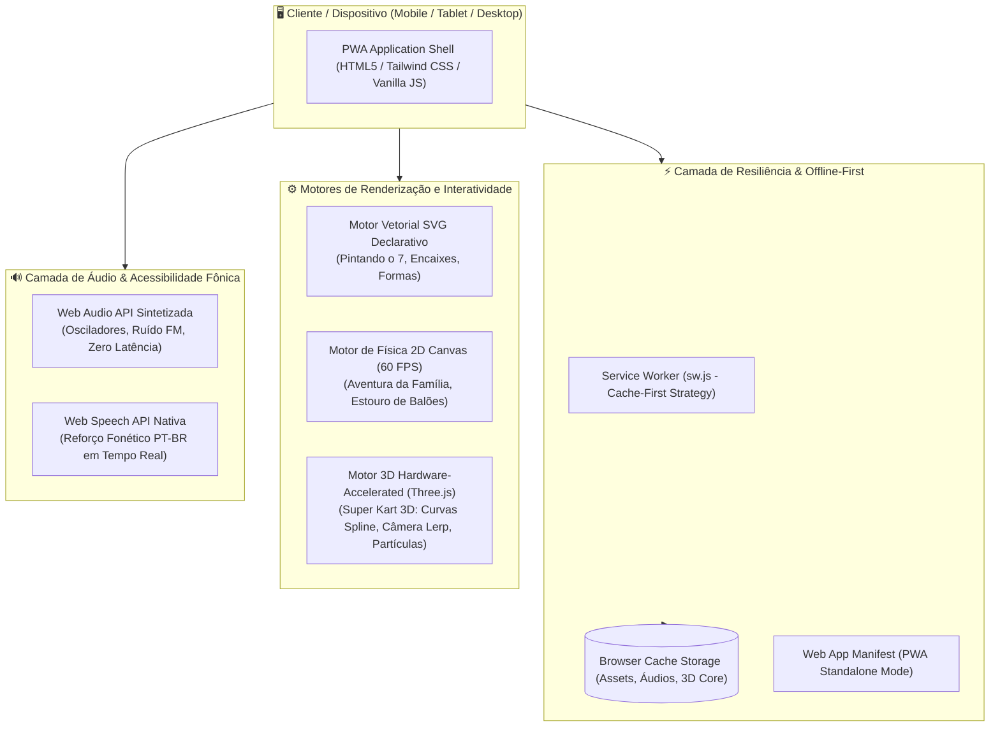

# 🎮 Kids EdTech Lab — Plataforma Web PWA de Jogos Educativos Infantis

> **Uma suíte interativa de jogos educativos de alta performance, desenvolvida com padrões web modernos (Offline-First, WebGL 3D, Canvas 2D, SVG reativo, Web Audio API e Web Speech API).**
> 
> *Desenvolvido com visão de Arquitetura de Soluções, Engenharia de Software e Engenharia de Produto AI-First.*

[](https://andersonrgs.github.io/jogos-educativos/)
[](https://andersonrgs.github.io/jogos-educativos/)
[](https://andersonrgs.github.io/jogos-educativos/)
[](https://andersonrgs.github.io/jogos-educativos/)

---

## 🧭 Origem & Visão de Produto

O projeto nasceu de uma **necessidade humana genuína**: criar um ecossistema digital seguro, educativo, acessível e livre de anúncios invasivos para meu filho pequeno em fase de alfabetização e desenvolvimento motor.

O que começou como protótipos lúdicos despretensiosos evoluiu para um **laboratório de engenharia de software de alta maturidade**. O projeto demonstra na prática como combinar:
1. **Design de Produto Centrado na Primeira Infância (UX Infantil):** Telas táteis com zonas de alcance ergonômicas, tolerância a toques imprecisos, feedback auditivo em tempo de execução e reforço positivo contínuo.
2. **Engenharia de Produto AI-First:** Aceleração do ciclo de entrega por meio de IA generativa (síntese e extração de assets visuais consistentes, pipelines vetoriais SVG e geração procedural) com validação e refinamento de ergonomia humano-no-loop (*human-in-the-loop*).
3. **Arquitetura de Soluções Resiliente e Zero-Lock-In:** Sem sobrecarga de frameworks monolíticos; 100% executável no navegador do cliente, multiplataforma (Android, iOS, Desktop), compatível com redes de baixa conectividade (Offline-First) e custo de hospedagem estático zero (Serverless / GitHub Pages).

---

## 🏛️ Destaques de Arquitetura de Software



### 1. Estratégia Offline-First & PWA
* **Cache-First com Invalidação Versionada:** O Service Worker intercepta requisições de rede, servindo assets críticos instantaneamente do cache local (`jogos-kids-v*`).
* **Instalação Nativa Sem Fricção:** Compatível com o ciclo de instalação de PWA em Android, iOS e navegadores desktop (ícones de alta resolução 192x192 e 512x512, modo *standalone* e safe-area insets).

### 2. Pipeline Gráfico Híbrido (Multi-Engine)
* **Motor Vetorial SVG Reativo:** Utilizado no jogo *Pintando o 7* e nos módulos de organização. Garante nitidez absoluta em qualquer densidade de pixels (Retina / 4K) com custo computacional mínimo.
* **Motor de Física 2D em Canvas (AABB Collision):** Loop de renderização determinístico a 60 FPS com detecção de colisão eficiente, câmera com suavização horizontal e sistema de partículas customizado.
* **Motor 3D WebGL (Three.js Local):** Utilizado no *Super Kart 3D*. Traçado baseado em curvas de spline Catmull-Rom contínuas, sombreamento dinâmico, física de derrapagem (*drift*), inteligência artificial de oponentes e renderização de partículas a 60 FPS em celulares modestos.

### 3. Síntese Sonora e Acessibilidade Fônica Nativa
* **Zero Overhead de Áudio com Web Audio API:** Efeitos como saltos, derrapagens, quebra de caixas e fanfarras são sintetizados em tempo real via osciladores senoidais/quadrados e modulação de ganho, eliminando centenas de requisições de rede para arquivos MP3.
* **Reforço Fonético com Web Speech API:** O navegador atua como narrador pedagógico em língua portuguesa, verbalizando números, letras, nomes de alimentos e palavras-chave para crianças em fase pré-escolar.

### 4. Privacy-by-Design & Conformidade
* **Zero PII (Personally Identifiable Information):** Arquitetura desenhada sob conformidade com diretrizes da LGPD (Brasil) e COPPA (Child Online Privacy Protection Act). Sem armazenamento de dados do usuário, sem cookies de terceiros, sem telemetrias invasivas.

---

## 📚 Matriz Pedagógica & Catálogo de Jogos

| Jogo | Tecnologia / Motor | Habilidade Pedagógica Desenvolvida | Mecânica Principal |
| :--- | :--- | :--- | :--- |
| **🎨 Pintando o 7** | SVG Vetorial + Web Speech | Coordenação motora fina, identificação numérica e cromática | Pintura por números com paleta progressiva (3 a 8 cores) e destaque visual |
| **🏎️ Super Kart 3D** | WebGL / Three.js 3D | Noção espacial, tempo de reação e controle reflexivo | Corrida 3D em circuito completo, drift com mini-turbo e itens estratégicos |
| **🍄 Aventura da Família** | Canvas 2D + Física AABB | Planejamento motor, persistência e hábitos saudáveis | Plataforma estilo arcade com coleta de frutas nutritivas e 3 cenários |
| **🔤 Letrinhas (ABC)** | DOM Reativo + Web Speech | Alfabetização precoce, consciência fonológica e ortografia | Encaixe de letras em palavras temáticas com pronúncia fonética |
| **🔢 Números & Contagem** | DOM / Audio API | Raciocínio lógico-matemático e contagem inicial | Associação visual de quantidades com áudio descritivo e somas simples |
| **🧸 Organiza Bagunça** | SVG Interativo / Drag & Drop | Categorização, lógica espacial e reconhecimento de padrões | Encaixe de brinquedos e objetos nas respectivas silhuetas sombreadas |
| **🐧 Quebra-Gelo do Pinguim** | Canvas 2D + Lógica Fuzzy | Previsão de causa e efeito, coordenação bilateral | Desafio de precisão ao martelar blocos de gelo sem derrubar o personagem |
| **🎈 Estoura Balão** | SVG Dinâmico + Canvas Partículas | Reconhecimento ágil de letras, cores e números | Estouro interativo com confetes e reforço sonoro |
| **🧠 Jogo da Memória** | CSS 3D Transforms (Flip Cards) | Memória de curto prazo e concentração visual | Cartas 3D de animais e frutas com rotação suave e narração |
| **👾 Rango Monstro** | SVG Animado + Áudio Lúdico | Educação nutricional e alimentação consciente | Monstrinho interativo que mastiga e reage aos alimentos oferecidos |
| **🎵 Sinfonia de Sons** | HTML5 Audio + Soundboard | Discriminação auditiva e repertório sociocultural | Acervo com 30 timbres reais (animais, veículos, dinossauros, instrumentos) |

---

## 🛠️ Stack Tecnológica

* **Core:** HTML5 Semântico, Vanilla JavaScript (ES6+), CSS3 Moderno (Custom Properties, Flexbox, CSS Grid).
* **Styling & Design System:** Tailwind CSS (via CDN) + Tipografia Google Fonts (*Fredoka*).
* **3D Graphics Engine:** Three.js (r128) empacotado localmente com fallback resiliente para CDN.
* **Audio & Speech:** Web Audio API nativa e Web Speech API (`SpeechSynthesis`).
* **PWA & Storage:** Service Worker API com Cache Storage e Web App Manifest.
* **Assets & Visual Design:** Pipeline AI-First (geração assistida por modelos generativos com tratamento e vetorização).

---

## 🚀 Como Executar Localmente

Como a plataforma é baseada em padrões web puros e arquitetura desacoplada, não há necessidade de etapas lentas de compilação (`npm install` / `build`):

1. **Clone o repositório:**
   ```bash
   git clone https://github.com/andersonrgs/jogos-educativos.git
   cd jogos-educativos
   ```

2. **Inicie um servidor estático local:**
   * Com Python 3:
     ```bash
     python3 -m http.server 8080
     ```
   * Com Node.js (`npx serve`):
     ```bash
     npx serve .
     ```
   * Ou simplesmente utilize a extensão **Live Server** no VS Code.

3. **Acesse no navegador:**
   Abra `http://localhost:8080` (ou teste diretamente o [Deploy no GitHub Pages](https://andersonrgs.github.io/jogos-educativos/)).

---

## 📈 Impacto & Aprendizados Técnicos

* **Performance em Hardware Restrito:** Otimização de render loops com `requestAnimationFrame`, descarte de objetos fora de visão (*frustum culling* e simplificação de geometrias Three.js) para garantir 60 FPS consistentes em smartphones de entrada.
* **UX para Não-Leitores:** Interface orientada a ícones, contraste de cores (*WCAG AAA* para público infantil), áreas de toque ampliadas (mínimo de 48x48px) e feedback multimodal (áudio + visual + tátil).
* **Iteração Ágil com IA:** Demonstração prática de como um único engenheiro pode atuar como time completo (Product Manager, UX Designer, Frontend Developer e QA) através da orquestração de ferramentas generativas modernas.

---

## 📄 Licença

Distribuído sob a licença **MIT**. Veja o arquivo `LICENSE` para mais detalhes.

---

<p align="center">
  Desenvolvido com carinho para crianças • Código limpo, acessível e sem anúncios.
</p>
